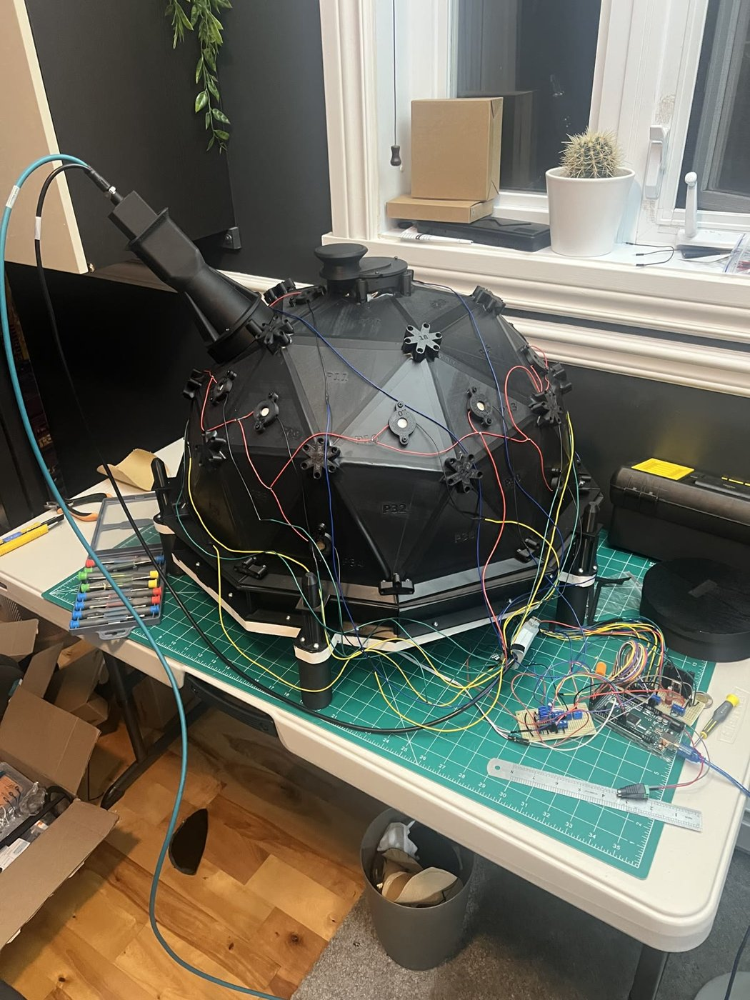

# Dome PS-16

**A low-cost LED dome for multi-view photometric stereo, built from scratch.**
Put a real object in, get a precise, textured 3D digital twin out.

The dome has 16 calibrated LEDs, a 5 MP industrial camera and a motorized turntable, all controlled by one Arduino Mega. One command on the computer scan the object under every light and from every turntable angle. The images are then fused in one textured mesh with a neural photometric stereo network (SDM-UniPS) and a neural signed distance surface (RNb-NeuS2).

On a 40 mm chess knight, the reconstructed model match the real dimensions to about 2 %.

The full method, the calibration and the results are explained in the technical paper: [`paper/Dome_PS16_technical_paper.pdf`](paper/Dome_PS16_technical_paper.pdf).

## What is in this repository

| Folder | Content |
|---|---|
| [`paper/`](paper/) | Technical paper (PDF + LaTeX source and figures) |
| [`hardware/stl/`](hardware/stl/) | All the parts to 3D print, sorted by material |
| [`hardware/cad/`](hardware/cad/) | Parametric 3D model of the dome (Python) used to generate the STL files |
| [`electronics/`](electronics/) | Schematic, board layout and netlist |
| [`firmware/`](firmware/) | Arduino code of the dome and a Python example to drive it from a computer |
| [`docs/bill_of_materials.md`](docs/bill_of_materials.md) | Every part I bought, with supplier references |
| [`media/`](media/) | Photos and renders |

## How it works

1. **Capture.** At each turntable position, the Arduino turn on one LED, trigger the camera, and repeat for the 16 LEDs. Then the turntable turn of 10°. 36 positions per turn, about one minute for 576 images.
2. **Calibration.** Camera intrinsics from a checkerboard, LED directions from a mirror ball, LED power and vignetting from a white plate.
3. **Camera poses.** The object is glued on the calibration checkerboard, so the pose of every view is measured directly (PnP + RANSAC).
4. **Normals and albedo.** Estimated in each view with SDM-UniPS.
5. **Surface.** All views are fused in one surface with RNb-NeuS2, then meshed with Marching Cubes.
6. **Texture and render.** The albedo is applied in Houdini and the model is rendered in Solaris.

## Building your own

- **Print** the parts in [`hardware/stl/`](hardware/stl/):
  - `asa_dome_panels/`: the 40 triangle panels of the 2V geodesic dome (black ASA). Use `with_supports/` or `without_supports/` depending on your printer.
  - `petg_cf/`: star connectors, LED capsules, camera tower and adapters, feet, handles, motor plate.
  - `asa_enclosure/`: electronics enclosure and lid.
  - `pla_calibration/`: mirror ball seat, checkerboard holder, PTFE base and riser.
  - `test_prints/`: small corner tests to check the fit before printing the panels.
- **Buy** the parts in the [bill of materials](docs/bill_of_materials.md).
- **Wire** the electronics following [`electronics/`](electronics/).
- **Flash** [`firmware/dome_ps16.ino`](firmware/dome_ps16.ino) on the Arduino Mega, then use [`firmware/pc_example.py`](firmware/pc_example.py) to start a capture.

A detailed step-by-step build guide is coming.

## Limitations

The colour-based mask only work on coloured objects, the field of view limit objects to about 12 cm, and transparent or very shiny materials are not supported. See the paper for the details and the next steps (validation with LEGO models).

## Author

Justin Desrochers, Polytechnique Montréal.
Thanks to Léane Tremblay for her help with the electronics.

## License

MIT, see [LICENSE](LICENSE).
