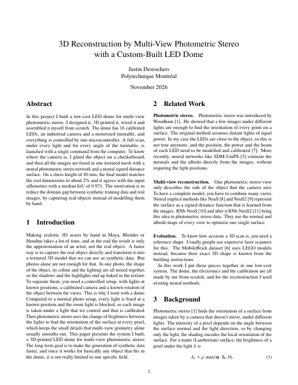
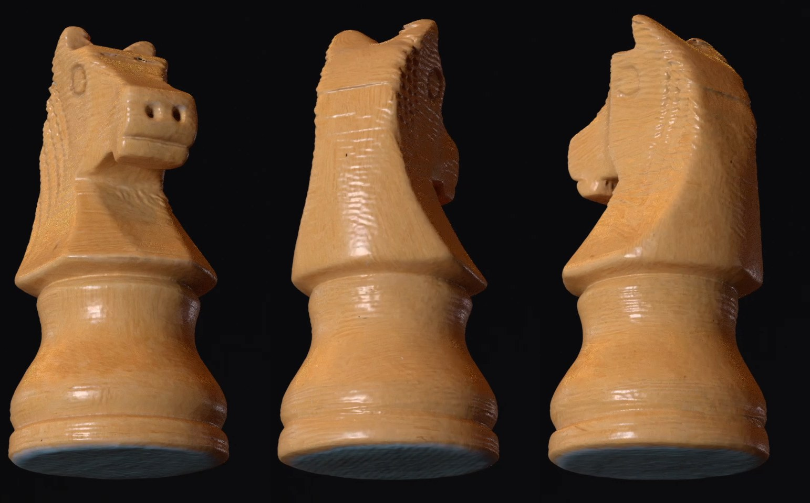

# Dome PS-16

**A low-cost LED dome for multi-view photometric stereo, built from scratch.**
Put a real object in, get a precise, textured 3D digital twin out.

**[Read the technical paper (PDF)](paper/Dome_PS16_technical_paper.pdf)** · **[Open the interactive 3D build guide](https://juju-dotcom.github.io/dome-ps16/docs/build_guide/)**

The dome has 16 calibrated LEDs, a 5 MP industrial camera and a motorized turntable, all controlled by one Arduino Mega. One command on the computer scans the object under every light and from every turntable angle. The images are then fused into one textured mesh with a neural photometric stereo network (SDM-UniPS) and a neural signed distance surface (RNb-NeuS2).

I designed and built it as a student project at Polytechnique Montréal (fall 2026).

## Technical paper

<a href="paper/Dome_PS16_technical_paper.pdf"></a>

**[3D Reconstruction by Multi-View Photometric Stereo with a Custom-Built LED Dome](paper/Dome_PS16_technical_paper.pdf)**<br>
Justin Desrochers, Polytechnique Montréal, November 2026<br>
6 pages · [PDF](paper/Dome_PS16_technical_paper.pdf) · [LaTeX source](paper/main.tex)

**Abstract.** In this project I built a low-cost LED dome for multi-view photometric stereo. I designed it, 3D printed it, wired it and assembled it myself from scratch. The dome has 16 calibrated LEDs, an industrial camera and a motorized turntable, and everything is controlled by one microcontroller. A full scan, under every light and for every angle of the turntable, is launched with a single command from the computer. To know where the camera is, I glued the object on a checkerboard, and then all the images are fused in one textured mesh with a neural photometric stereo network and a neural signed distance surface. On a chess knight of 40 mm, the final model matches the real dimensions to about 2% and it agrees with the input silhouettes with a median IoU of 0.971. The motivation is to reduce the domain gap between synthetic training data and real images, by capturing real objects instead of modelling them by hand.

<br clear="right">



## Interactive 3D build guide

**[Open the interactive build guide](https://juju-dotcom.github.io/dome-ps16/docs/build_guide/)**. Every step shows the parts to add in 3D, the breadboard plans and the full wiring schematic, with the instructions and the checks to do before moving on. It also works offline: download [`docs/build_guide/index.html`](docs/build_guide/index.html) and double-click it.

The same steps are also written as Markdown in [`docs/`](docs/).

## How it works

- **Dome**: 2V geodesic shell, 300 mm radius, 40 triangular panels printed in black ASA.
- **Lights**: 16 Luxeon star LEDs in printed capsules. An LM317 constant-current source (about 320 mA) feeds a common anode, and two ULN2803 arrays switch the cathodes, so only one LED is ever on.
- **Camera**: LUCID Triton TRI050S-CC (5 MP, raw output) with a 25 mm Fujinon lens, looking through an oblique port. Field of view is about 14 × 12 cm.
- **Turntable**: 160 mm plate on a NEMA 17 + TMC2209 (3200 microsteps per turn), with an optical fork for the zero position.
- **Controller**: Arduino Mega with an OLED, three buttons and a status LED. It turns on one LED, fires the camera trigger, waits for the exposure and moves on to the next LED.

## Measured performance

| What | Result |
|---|---|
| Camera calibration, reprojection error | 0.10 px (median) |
| LED directions vs CAD | 2.2° median, 3.8° max |
| LED distances vs CAD | 17 mm median, 79 mm max |
| Turntable angle repeatability | 0.047° (median) |
| Reconstructed chess knight (40 mm) vs real size | +0.87 mm in height (about 2 %) |
| Silhouette agreement (IoU) | 0.971 (median) |

The full method, the calibration and the results are in the technical paper: [`paper/Dome_PS16_technical_paper.pdf`](paper/Dome_PS16_technical_paper.pdf).

## Repository layout

```
docs/       build guide: interactive 3D version + 6 Markdown sections + wiring reference
hardware/   printable STLs, print settings, base board template, parts list (CSV)
firmware/   Arduino sketch (serial protocol, buttons, OLED)
paper/      technical paper (PDF + LaTeX source)
media/      photos and renders
```

## Building one

1. Print the parts listed in [hardware/README.md](hardware/README.md).
2. Buy the parts in the [bill of materials](docs/bill_of_materials.md).
3. Follow the [interactive build guide](https://juju-dotcom.github.io/dome-ps16/docs/build_guide/) or the Markdown guide in [docs/](docs/).
4. Flash [firmware/dome_ps16](firmware/dome_ps16/) with the Arduino IDE (libraries: AccelStepper, Adafruit NeoPixel, U8g2).

## Firmware commands

The board listens on USB serial at 115200 baud, one command per line.

| Command | What it does |
|---|---|
| `STATUS` | prints the current state |
| `LED <1-16>` | turns on one LED (auto off after 10 s) |
| `SEQ <exposure_ms> [wait_ms]` | runs all 16 LEDs with a camera trigger for each |
| `HOME` | finds the turntable zero |
| `ROT <deg>` / `GOTO <deg>` | relative / absolute turntable move |
| `OFF` | stops everything |

## Known issues

- The LED distances from the calibration are less precise than the directions (17 mm median error, 79 mm max).

## Citation

```bibtex
@techreport{desrochers2026domeps16,
  author      = {Justin Desrochers},
  title       = {{3D} Reconstruction by Multi-View Photometric Stereo with a Custom-Built {LED} Dome},
  institution = {Polytechnique Montr{\'e}al},
  type        = {Technical report},
  month       = nov,
  year        = {2026}
}
```

## Author

Justin Desrochers, Polytechnique Montréal.
Thanks to Léane Tremblay for her help with the electronics.

## License

MIT, see [LICENSE](LICENSE).
